# Hey there! I'm Piyush Dave

### Data Analyst | Turning Raw Data into Business Insights

  
  
  
  
  

  <a href="#about">About</a> ·
  <a href="#work-experience">Experience</a> ·
  <a href="#featured-projects">Featured Projects</a> ·
  <a href="#more-projects">More Projects</a> ·
  <a href="#skills">Skills</a> ·
  <a href="#lets-connect">Contact</a>

---

## About

I'm **Piyush Dave**, a Data Analyst who turns business questions into clear findings. I have 12 months of hands-on experience across **two virtual internships**, **15+ projects** and **15+ dashboards** in e-commerce, retail, banking, sports and restaurant data.

**What I bring**

- **Clean, trustworthy data:** SQL and Python for cleaning, validation and quality checks
- **Dashboards people actually use:** Power BI and Tableau KPI dashboards with filters
- **Answers, not just charts:** root-cause analysis and prioritized recommendations

**Right now:** based in Amravati, open to relocate, and looking for a full-time Data Analyst role. B.E. in Electronics & Telecommunication (2025).

---

## Work Experience

### Data Analytics Virtual Intern · InsightNest
*May 2026 – Aug 2026 · [Repository](https://github.com/PiyushDave30/InsightNest-Virtual-Internship)*

- Delivered 3 Power BI projects and 1 business case study with the Analytics & Career Excellence team.
- **E-commerce Analytics:** 6-page dashboard on 1,000 orders and 326 customers.
- **NovaKart Analytics:** 39 business questions on revenue, delivery, returns and customers, ending in one quantified recommendation.
- **Global Movie Success (team project):** built the 5-page dashboard and DAX on 100,000+ movies; a teammate handled the Python analysis.
- **Marlow & Finch case study:** wrote an initial-understanding document and a questionnaire for a fictional retailer (no dataset).

### Data Analyst Virtual Intern · AI Variant (ExcelR program)
*Jul 2025 – Apr 2026 · [Repository](https://github.com/PiyushDave30/data-analyst-project-portfolio)*

- Completed 3 end-to-end projects: Adventure Works ($29.4M, 50,000+ rows), Atliq Hospitality (₹1.71bn revenue, 135K bookings) and HR Attrition (50,000 employees, 50.21% attrition).
- Wrote 15+ SQL queries (joins, aggregations, stored procedures, KPI views) and built Power BI and Tableau dashboards tracking 6 KPIs.
- Found 2012 as the peak revenue year and Q4 as the strongest quarter, to guide inventory and campaign planning.

---

## Featured Projects

<table>
  <tr>
    <td width="50%" valign="top">
      
      <h3>NovaKart Analytics Dashboard</h3>
      
39 business questions on revenue, delivery, returns and customers, ending in one quantified recommendation.

      

      <a href="https://github.com/PiyushDave30/InsightNest-Virtual-Internship/tree/main/04_NovaKart-Analytics-Dashboard">View Project →</a>
    </td>
    <td width="50%" valign="top">
      
      <h3>E-commerce Analytics Dashboard</h3>
      
6-page dashboard on 1,000 orders: sales, customers, returns and marketing.

      

      <a href="https://github.com/PiyushDave30/InsightNest-Virtual-Internship/tree/main/01_Ecommerce-Analytics-Dashboard">View Project →</a>
    </td>
  </tr>
  <tr>
    <td width="50%" valign="top">
      
      <h3>Marlow &amp; Finch: Sales &amp; Margin Diagnostic</h3>
      
Practice case study with no dataset: an initial-understanding document and a questionnaire.

      

      <a href="https://github.com/PiyushDave30/InsightNest-Virtual-Internship/tree/main/02-Marlow-Finch-Case-Study">View Project →</a>
    </td>
    <td width="50%" valign="top">
      
      <h3>Global Movie Success Analysis</h3>
      
100,000+ movies analyzed. Team project: I built the Power BI dashboard and DAX.

      
 

      <a href="https://github.com/PiyushDave30/InsightNest-Virtual-Internship/tree/main/03_Global-Movie-Success-Analysis">View Project →</a>
    </td>
  </tr>
  <tr>
    <td width="50%" valign="top">
      
      <h3>Zomato Sales &amp; Rating Analysis</h3>
      
9,551 restaurants in 15 countries: advanced SQL and a 3-page Tableau dashboard.

      
 

      <a href="https://github.com/PiyushDave30/data-analyst-project-portfolio/tree/main/04_Zomato-Sales-Rating-Analysis">View Project →</a>
    </td>
    <td width="50%" valign="top">
      
      <h3>IPL Analysis (2008–2025)</h3>
      
18 seasons and 2,78,205 deliveries explored in Python.

      

      <a href="https://github.com/PiyushDave30/data-analyst-project-portfolio/tree/main/06_IPL-Analysis">View Project →</a>
    </td>
  </tr>
  <tr>
    <td width="50%" valign="top">
      
      <h3>Amravati AQI Analysis 2024</h3>
      
Self-collected CPCB air quality data, cleaned in Python and shown in Power BI.

      
  

      <a href="https://github.com/PiyushDave30/data-analyst-project-portfolio/tree/main/08_Amravati-AQI-2024-Analysis">View Project →</a>
    </td>
    <td width="50%" valign="top">
      
      <h3>HR Attrition Analysis</h3>
      
50,000 employees analyzed end to end in SQL, Power BI, Tableau and Excel.

      
   

      <a href="https://github.com/PiyushDave30/data-analyst-project-portfolio/tree/main/03_HR-Attrition-Analysis">View Project →</a>
    </td>
  </tr>
</table>

---

## More Projects

9 more projects beyond the featured eight. Click a tool to see only those projects, or [browse the full repository](https://github.com/PiyushDave30/data-analyst-project-portfolio).

 &nbsp;<b>4 projects</b> (click to open)

- **[Adventure Works Analysis](https://github.com/PiyushDave30/data-analyst-project-portfolio/tree/main/01_Adventure-Works-Analysis)**: End-to-end analysis of Sales, Profit and Orders ($29.4M, 50,000+ rows): cleaning, SQL queries and dashboards in each tool.
- **[Hospitality Analysis](https://github.com/PiyushDave30/data-analyst-project-portfolio/tree/main/02_Hospitality-Analysis)**: Revenue, occupancy, bookings and cancellations across 7 Atliq hotels in 4 Indian cities (₹1.71bn revenue, 135K bookings).
- **[Swiggy Analysis Using SQL](https://github.com/PiyushDave30/data-analyst-project-portfolio/tree/main/09_Swiggy-Analysis)**: 1,97,430 orders, 993 restaurants, 28 cities and 59,064 dishes, using views, stored procedures, window functions and subqueries.
- **[Bank Loan Analysis](https://github.com/PiyushDave30/data-analyst-project-portfolio/tree/main/07_Bank-Analysis)**: 20+ queries covering EDA, customer profiling, financial risk, stored procedures, views and window functions.

 &nbsp;<b>6 projects</b> (click to open)

- **[Adventure Works Analysis](https://github.com/PiyushDave30/data-analyst-project-portfolio/tree/main/01_Adventure-Works-Analysis)**: End-to-end analysis of Sales, Profit and Orders ($29.4M, 50,000+ rows): cleaning, SQL queries and dashboards in each tool.
- **[Hospitality Analysis](https://github.com/PiyushDave30/data-analyst-project-portfolio/tree/main/02_Hospitality-Analysis)**: Revenue, occupancy, bookings and cancellations across 7 Atliq hotels in 4 Indian cities (₹1.71bn revenue, 135K bookings).
- **[Blinkit Sales Performance Dashboard](https://github.com/PiyushDave30/data-analyst-project-portfolio/tree/main/05_Blinkit-Sales-Dashboard)**: 5-page dashboard on products, outlets, locations and customer preferences, with Excel for cleaning and preparation.
- **[India Sales Dashboard](https://github.com/PiyushDave30/data-analyst-project-portfolio/tree/main/10_India-Sales-Dashboard)**: 5-page dashboard on sales, profit and manager performance across regions, categories, cities and states.
- **[Brew Metric: Coffee Shop Analytics](https://github.com/PiyushDave30/data-analyst-project-portfolio/tree/main/12_Coffee-Shop-Analytics)**: 7-page dashboard for a fictional coffee chain: 5,000 orders, 5 branches, 17 products, on a custom PowerPoint-designed background.
- **[Practice Dashboards](https://github.com/PiyushDave30/data-analyst-project-portfolio/tree/main/11_Practice-Dashboards)**: Tableau Superstore and Power BI Finance dashboards to practice design and business reporting.

 &nbsp;<b>4 projects</b> (click to open)

- **[Adventure Works Analysis](https://github.com/PiyushDave30/data-analyst-project-portfolio/tree/main/01_Adventure-Works-Analysis)**: End-to-end analysis of Sales, Profit and Orders ($29.4M, 50,000+ rows): cleaning, SQL queries and dashboards in each tool.
- **[Hospitality Analysis](https://github.com/PiyushDave30/data-analyst-project-portfolio/tree/main/02_Hospitality-Analysis)**: Revenue, occupancy, bookings and cancellations across 7 Atliq hotels in 4 Indian cities (₹1.71bn revenue, 135K bookings).
- **[BMW Sales Analytics](https://github.com/PiyushDave30/data-analyst-project-portfolio/tree/main/13_BMW-Sales-Analytics)**: 7-page dashboard on 6 models and 4 regions: 200 sales records, 1,974 units and $117.28M revenue.
- **[Practice Dashboards](https://github.com/PiyushDave30/data-analyst-project-portfolio/tree/main/11_Practice-Dashboards)**: Tableau Superstore and Power BI Finance dashboards to practice design and business reporting.

 &nbsp;<b>3 projects</b> (click to open)

- **[Adventure Works Analysis](https://github.com/PiyushDave30/data-analyst-project-portfolio/tree/main/01_Adventure-Works-Analysis)**: End-to-end analysis of Sales, Profit and Orders ($29.4M, 50,000+ rows): cleaning, SQL queries and dashboards in each tool.
- **[Hospitality Analysis](https://github.com/PiyushDave30/data-analyst-project-portfolio/tree/main/02_Hospitality-Analysis)**: Revenue, occupancy, bookings and cancellations across 7 Atliq hotels in 4 Indian cities (₹1.71bn revenue, 135K bookings).
- **[Blinkit Sales Performance Dashboard](https://github.com/PiyushDave30/data-analyst-project-portfolio/tree/main/05_Blinkit-Sales-Dashboard)**: 5-page dashboard on products, outlets, locations and customer preferences, with Excel for cleaning and preparation.

---

## Skills

<b>Full skills list</b>

- **SQL:** MySQL, joins, subqueries, aggregations, window functions, stored procedures, views, KPI queries
- **Python:** Pandas, NumPy, Matplotlib, Seaborn, Jupyter Notebook, EDA, data wrangling, feature engineering
- **Power BI and Tableau:** DAX, Power Query, data modeling, star schema, dashboard design, KPI reporting, parameters
- **Excel:** Power Query, pivot tables, pivot charts, data cleaning, dashboards
- **Analytics:** data cleaning and validation, KPI analysis, trend analysis, YoY growth, root-cause analysis, customer segmentation, correlation and standard deviation, data storytelling
- **General:** communication, problem solving, critical thinking, attention to detail, teamwork, stakeholder communication, time management, quick learning

---

## Education & Certifications

- **B.E. Electronics & Telecommunication**, Prof. Ram Meghe Institute of Technology and Research, 2021 – 2025, CGPA 7.64
- **HSC**, S.F.L High School and Junior College, 2019 – 2021, 85.67%
- **Certifications:** Data Analyst (ExcelR) · Certificate Program in Data Analytics (NASSCOM) · Data Analytics Job Simulation (Deloitte, Forage)

---

## My Journey

  

---

## Insights I've Found

- **E-commerce:** Electronics brought in 53% of revenue but only 31% of profit, Fashion had the highest margin, and discounts above 20% caused losses.
- **Returns and customers:** the 8.2% return rate cost 18.37K in revenue (Fashion returns 14.16%). Repeat buyers were 84% of customers and 95% of revenue, and December was the peak month, so inventory should be planned before Q4.
- **Marketing:** Organic Search was the top channel (63K revenue, 18K profit) and Affiliate the weakest (23K revenue). Weekdays earned twice the revenue of weekends.
- **Zomato:** outlets with online delivery and table booking averaged a 3.5 rating against 2.8 for those without. This shows association, not causation.
- **IPL:** sixes per season rose from 623 to 1,302 and the average run rate from 7.98 to 9.20, with overs 17–18 the highest-scoring phase.
- **Movies:** Sci-Fi, Fantasy and Adventure led revenue. Budget and audience score moved with revenue but did not guarantee it.
- **Air quality (Amravati 2024):** average AQI 85.86, with the Q3 monsoon the cleanest quarter at 38.95.

---

## Let's Connect

I am actively looking for **full-time Data Analyst opportunities**. If you are hiring or know someone who is, I would love to hear from you.

⭐ If you find any project useful, feel free to star the repo!

*Open to full-time Data Analyst roles: Amravati, Maharashtra, relocation or remote*

