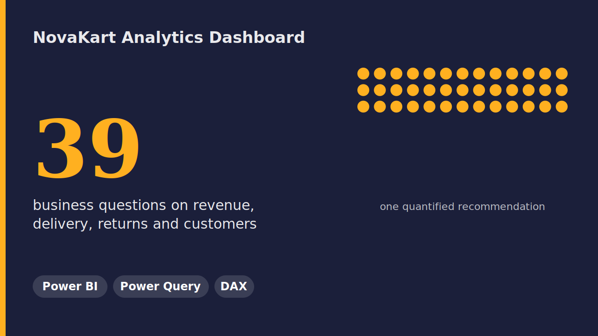
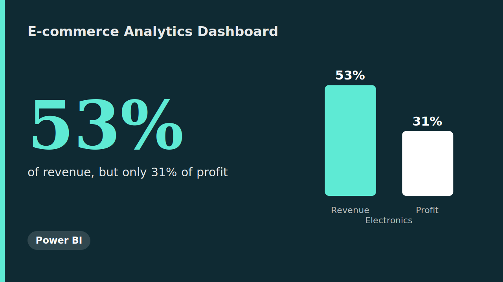
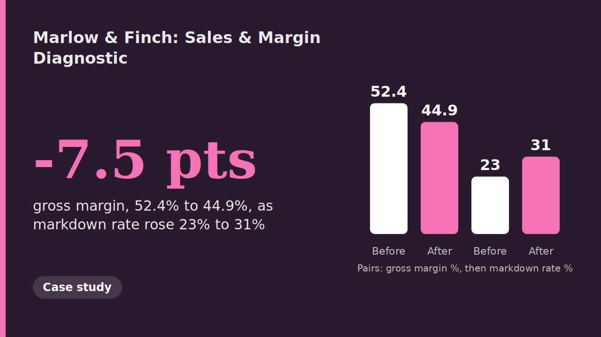
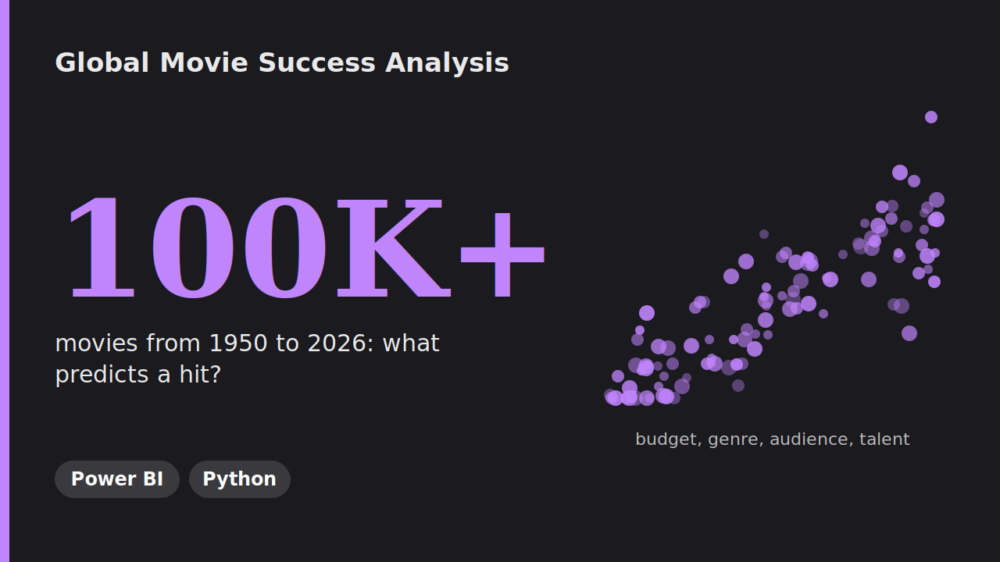
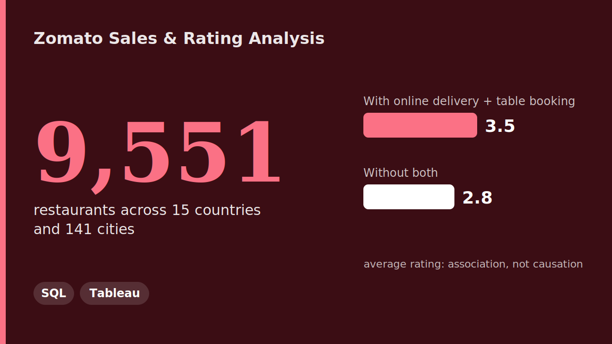
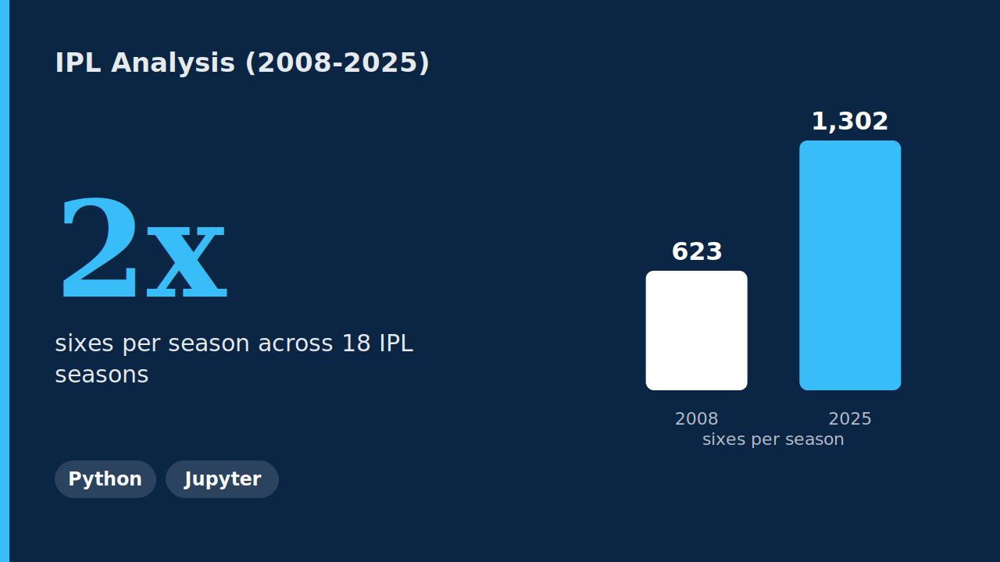
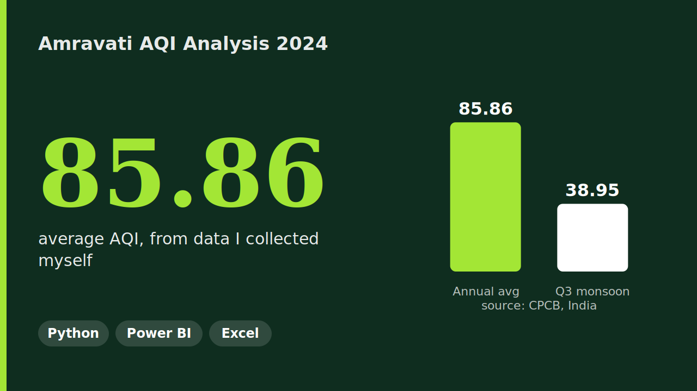
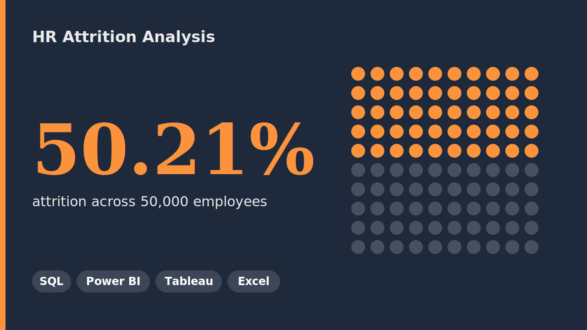

<div align="center">

# Hey there! I'm Piyush Dave

### Data Analyst | Turning Raw Data into Business Insights

<p>
  <a href="https://www.linkedin.com/in/piyushdave30/">
    
  </a>
  <a href="https://public.tableau.com/app/profile/piyushdave/vizzes">
    
  </a>
  <a href="mailto:piyushdave3008@gmail.com">
    
  </a>
  <a href="https://piyushdave30.github.io/">
    
  </a>
</p>

</div>

---

<div align="center">
  
</div>

---

## How I Work

<table>
  <tr>
    <td width="33%" align="center"><h3>1. Ask</h3>Start with the business question, not the data.</td>
    <td width="33%" align="center"><h3>2. Clean</h3>Validate and clean the data before any chart is built.</td>
    <td width="33%" align="center"><h3>3. Explain</h3>Turn the dashboard into findings and a clear next step.</td>
  </tr>
</table>

## My Journey

```text
2021 - 2025   B.E. Electronics & Telecommunication, PRMITR
Jul 2025      Started data analytics: ExcelR Data Analyst program, AI Variant internship
May 2026      InsightNest internship: Power BI projects and a business case study
Today         Building dashboards and open to full-time Data Analyst roles
```

---

## My Tech Stack

<div align="center">


</div>

---

## General Skills

<div align="center">

**Communication** · **Problem solving** · **Critical thinking** · **Attention to detail** · **Teamwork** · **Stakeholder communication** · **Time management** · **Quick learning**

</div>

---

## Experience

<table>
  <tr>
    <td width="50%">
      <h3>Data Analytics Virtual Intern, InsightNest</h3>
      <p><i>May 2026 – Aug 2026</i></p>
      <p>3 Power BI projects (E-commerce Analytics, NovaKart, Global Movie Success) and 1 business case study (Marlow &amp; Finch).</p>
      <a href="https://github.com/PiyushDave30/InsightNest-Virtual-Internship">View Repo →</a>
    </td>
    <td width="50%">
      <h3>Data Analyst Virtual Intern, AI Variant (ExcelR)</h3>
      <p><i>Jul 2025 – Apr 2026</i></p>
      <p>3 end-to-end projects (Adventure Works, Atliq Hospitality, HR Attrition): data cleaning, SQL queries, and dashboards in Power BI, Tableau and Excel.</p>
      <a href="https://github.com/PiyushDave30/data-analyst-project-portfolio">View Repo →</a>
    </td>
  </tr>
</table>

---

## Featured Projects

<table>
  <tr>
    <td width="50%">
      
      <h3>NovaKart Analytics Dashboard</h3>
      <p>Finds where a founder is losing money: 39 business questions on revenue, delivery, returns and customers, closing with one quantified recommendation.</p>
      <p>
        
      </p>
      <a href="https://github.com/PiyushDave30/InsightNest-Virtual-Internship/tree/main/04_NovaKart-Analytics-Dashboard">View Project →</a>
    </td>
    <td width="50%">
      
      <h3>E-commerce Analytics Dashboard</h3>
      <p>6-page dashboard on 1,000 orders. Electronics brought in 53% of revenue but only 31% of profit; discounts above 20% caused losses.</p>
      <p>
        
      </p>
      <a href="https://github.com/PiyushDave30/InsightNest-Virtual-Internship/tree/main/01_Ecommerce-Analytics-Dashboard">View Project →</a>
    </td>
  </tr>
  <tr>
    <td width="50%">
      
      <h3>Marlow &amp; Finch: Sales &amp; Margin Diagnostic</h3>
      <p>Practice client case study on a fictional retailer, with no dataset. I wrote an initial-understanding document and a questionnaire to frame the business problem (margin 52.4% to 44.9%, markdown rate 23% to 31%).</p>
      <p>
        
      </p>
      <a href="https://github.com/PiyushDave30/InsightNest-Virtual-Internship/tree/main/02-Marlow-Finch-Case-Study">View Project →</a>
    </td>
    <td width="50%">
      
      <h3>Global Movie Success Analysis</h3>
      <p>Team project on 100,000+ movies (1950–2026). I built the Power BI dashboard and DAX; a teammate did the Python cleaning and statistics.</p>
      <p>
        
        
      </p>
      <a href="https://github.com/PiyushDave30/InsightNest-Virtual-Internship/tree/main/03_Global-Movie-Success-Analysis">View Project →</a>
    </td>
  </tr>
  <tr>
    <td width="50%">
      
      <h3>Zomato Sales &amp; Rating Analysis</h3>
      <p>9,551 restaurants across 15 countries and 141 cities, with advanced SQL and a 3-page Tableau dashboard.</p>
      <p>
        
        
      </p>
      <a href="https://github.com/PiyushDave30/data-analyst-project-portfolio/tree/main/04_Zomato-Sales-Rating-Analysis">View Project →</a>
    </td>
    <td width="50%">
      
      <h3>IPL 18-Season Analysis</h3>
      <p>EDA on 18 seasons: 1,169 matches and 2,78,205 deliveries with Pandas, NumPy, Matplotlib and Seaborn.</p>
      <p>
        
      </p>
      <a href="https://github.com/PiyushDave30/data-analyst-project-portfolio/tree/main/06_IPL-Analysis">View Project →</a>
    </td>
  </tr>
  <tr>
    <td width="50%">
      
      <h3>Amravati AQI Analysis 2024</h3>
      <p>Air quality data I collected from India's CPCB website, cleaned in Python and shown in a 3-page Power BI dashboard. Average AQI 85.86.</p>
      <p>
        
        
        
      </p>
      <a href="https://github.com/PiyushDave30/data-analyst-project-portfolio/tree/main/08_Amravati-AQI-2024-Analysis">View Project →</a>
    </td>
    <td width="50%">
      
      <h3>HR Attrition Analysis</h3>
      <p>50,000 employees: attrition, salary and department performance, built end to end in SQL, Power BI, Tableau and Excel.</p>
      <p>
        
        
        
        
      </p>
      <a href="https://github.com/PiyushDave30/data-analyst-project-portfolio/tree/main/03_HR-Attrition-Analysis">View Project →</a>
    </td>
  </tr>
</table>

<details>
<summary><b>Show the other 9 projects</b></summary>

| Project | Tools | What it shows | Link |
|---|---|---|---|
| Adventure Works Analysis | SQL, Power BI, Tableau, Excel | Sales, profit and orders ($29.4M) | [Open](https://github.com/PiyushDave30/data-analyst-project-portfolio/tree/main/01_Adventure-Works-Analysis) |
| Hospitality Analysis | SQL, Power BI, Tableau, Excel | 7 Atliq hotels, 4 cities, ₹1.71bn revenue | [Open](https://github.com/PiyushDave30/data-analyst-project-portfolio/tree/main/02_Hospitality-Analysis) |
| Blinkit Sales Dashboard | Excel, Power BI | 5-page dashboard on products, outlets and customers | [Open](https://github.com/PiyushDave30/data-analyst-project-portfolio/tree/main/05_Blinkit-Sales-Dashboard) |
| Swiggy Analysis | MySQL | 1,97,430 orders, views, stored procedures, window functions | [Open](https://github.com/PiyushDave30/data-analyst-project-portfolio/tree/main/09_Swiggy-Analysis) |
| Bank Loan Analysis | MySQL | 20+ queries on customer profiling and financial risk | [Open](https://github.com/PiyushDave30/data-analyst-project-portfolio/tree/main/07_Bank-Analysis) |
| India Sales Dashboard | Power BI | 5-page dashboard on sales, profit and managers | [Open](https://github.com/PiyushDave30/data-analyst-project-portfolio/tree/main/10_India-Sales-Dashboard) |
| Brew Metric Coffee Shop | Power BI, PowerPoint | 7-page dashboard, 5,000 orders, 5 branches | [Open](https://github.com/PiyushDave30/data-analyst-project-portfolio/tree/main/12_Coffee-Shop-Analytics) |
| BMW Sales Analytics | Tableau, PowerPoint | 7-page dashboard, 1,974 units, $117.28M revenue | [Open](https://github.com/PiyushDave30/data-analyst-project-portfolio/tree/main/13_BMW-Sales-Analytics) |
| Practice Dashboards | Tableau, Power BI | Superstore and Finance dashboards | [Open](https://github.com/PiyushDave30/data-analyst-project-portfolio/tree/main/11_Practice-Dashboards) |

</details>

---

## What I Have Built

<div align="center">

| | |
|---|---|
| **SQL Projects** | Adventure Works · Hospitality · HR Attrition · Zomato · Bank Loan · Swiggy |
| **Power BI Dashboards** | Adventure Works · Hospitality · HR Attrition · Blinkit · India Sales · AQI · Coffee Shop · E-commerce · NovaKart · Global Movie Success |
| **Tableau Dashboards** | Adventure Works · Hospitality · HR Attrition · Zomato · BMW Sales Analytics |
| **Python Projects** | IPL 18-Season EDA · Amravati AQI Cleaning |
| **Excel Dashboards** | Adventure Works · Hospitality · HR Attrition · Blinkit |

</div>

---

## By The Numbers

<div align="center">

**15+ Projects** &nbsp;&nbsp;|&nbsp;&nbsp; **15+ Dashboards** &nbsp;&nbsp;|&nbsp;&nbsp; **2 Internships** &nbsp;&nbsp;|&nbsp;&nbsp; **25+ Python Charts**

**2,78,205** IPL deliveries analyzed &nbsp;&nbsp;|&nbsp;&nbsp; **1,97,430** Swiggy orders analyzed

Real AQI data from **CPCB Government Website**

</div>

---

## Let's Connect

I am actively looking for **full-time Data Analyst opportunities**. If you are hiring or know someone who is, I would love to connect!

<div align="center">

[](https://www.linkedin.com/in/piyushdave30/)
[](https://public.tableau.com/app/profile/piyushdave/vizzes)
[](https://github.com/PiyushDave30/data-analyst-project-portfolio)

</div>

---

<div align="center">

⭐ If you find any project useful, feel free to star the repo!

*Open to full-time Data Analyst roles: Amravati, Maharashtra, relocation or remote*

</div>
